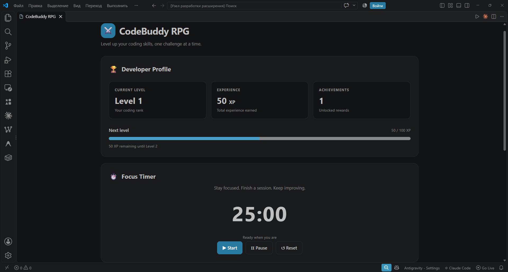
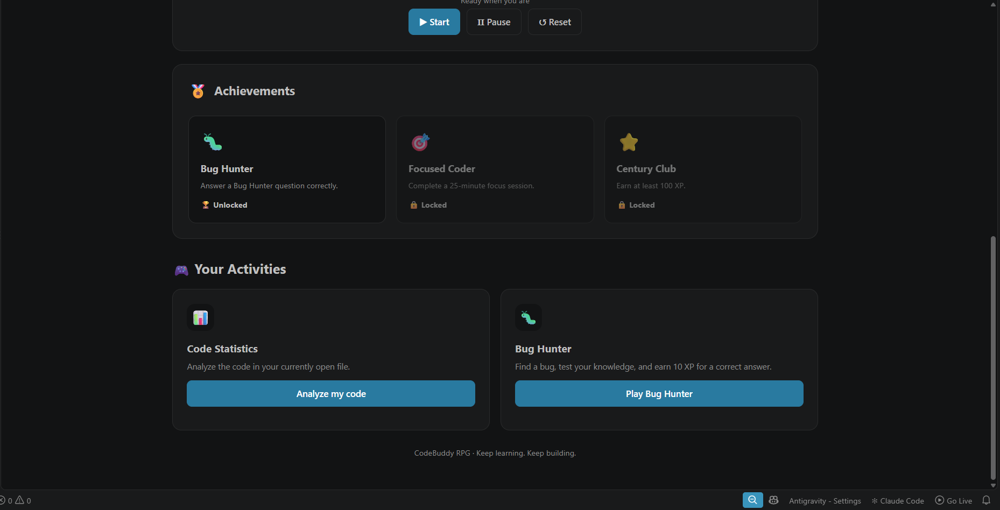
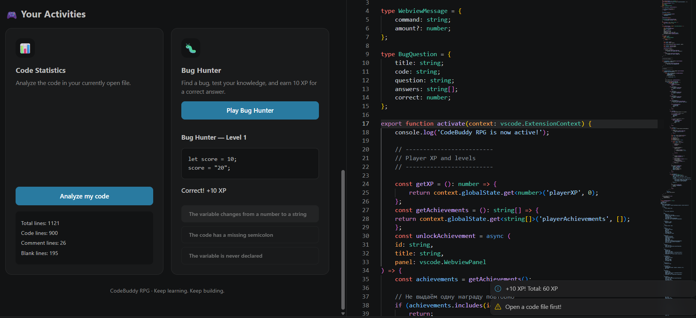

# 🎮 CodeBuddy RPG

<p align="center">
  <strong>Your coding journey, upgraded.</strong>
  <br />
  A gamified productivity companion for Visual Studio Code.
</p>

<p align="center">
  
  
  
</p>

---

## 📖 About the Project

**CodeBuddy RPG** is a Visual Studio Code extension that turns everyday coding into an RPG-style experience.

Track your progress, earn experience points, unlock achievements, focus with a Pomodoro timer, analyze your code, and test your debugging skills.

The goal is to make coding sessions more engaging while encouraging productive habits and continuous learning.

## ✨ Features

| Feature | Description |
|---|---|
| 👤 Developer Profile | View your level, experience points, and achievements. |
| ⏱️ Focus Timer | Use a 25-minute Pomodoro session to concentrate on coding. |
| 📊 Code Statistics | Analyze basic statistics of the active source file. |
| 🐛 Bug Hunter | Find bugs and practice debugging with interactive questions. |
| ⭐ XP and Levels | Earn XP and progress through levels. |
| 🏆 Achievements | Unlock achievements by completing activities. |
| ⌨️ Keyboard Shortcut | Open the dashboard with `Ctrl + Alt + G`. |
| 🖱️ Editor Context Menu | Open the dashboard directly from the editor's right-click menu. |

## 🖼️ Screenshots

### Dashboard and Developer Profile

<!-- Replace the path below with the exact screenshot filename. -->


### Focus Timer and Code Statistics



### Bug Hunter and Achievements



## 🚀 Getting Started

### Prerequisites

- [Visual Studio Code](https://code.visualstudio.com/)
- [Node.js](https://nodejs.org/)
- npm (included with Node.js)

### Installation

1. Clone this repository:

   ```bash
   git clone <YOUR_GITHUB_REPOSITORY_URL>
   ```

2. Navigate to the project directory:

   ```bash
   cd codebuddy-rpg
   ```

3. Install the dependencies:

   ```bash
   npm install
   ```

4. Compile the extension:

   ```bash
   npm run compile
   ```

### Run in Development Mode

1. Open the project folder in Visual Studio Code.
2. Press `F5` to launch the Extension Development Host.
3. Open the Command Palette with `Ctrl + Shift + P`.
4. Run `CodeBuddy RPG: Open Dashboard`.

You can also open the dashboard using `Ctrl + Alt + G` or the editor's right-click context menu.

## 🛠️ Built With

- **TypeScript** — extension logic and functionality.
- **Visual Studio Code Extension API** — commands, keyboard shortcuts, and editor integration.
- **HTML** — dashboard structure.
- **CSS** — dashboard styling.
- **JavaScript** — dashboard interactions.
- **Node.js and npm** — development environment and dependency management.

## 📂 Project Structure

```text
codebuddy-rpg/
├── src/
│   └── extension.ts
├── screenshots/
├── package.json
├── package-lock.json
├── tsconfig.json
└── README.md
```

## 🎯 Project Goals

- Make coding sessions more engaging.
- Encourage focused work through timed sessions.
- Provide quick feedback about source code.
- Practice debugging through interactive challenges.
- Reward progress with XP, levels, and achievements.

## 👨‍💻 Author

- **Author:** [Hudaybergenow Suleyman]
- **Group:** [M3125]
- **Project:** Educational assignment

## 📄 License

This project was created for educational purposes.
